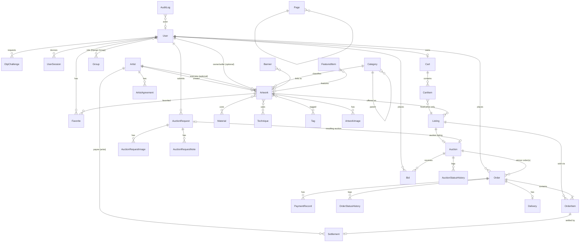

# ERD.md — نموذج البيانات (v2 — 2026-11-03)

> قاعدة البيانات: PostgreSQL 16. كل الجداول تحمل `id` (BigAutoField)، و`created_at`/`updated_at` (timestamptz, UTC) ما لم يُذكر غير ذلك.
> المبالغ `numeric(12,2)` USD، النسب `numeric(5,2)`.
> قواعد العمل المذكورة (BR-xxx) في `BUSINESS_RULES.md`.
> **لا توجد أي جداول للتحقق من الأصالة (BR-004).**

---

## 1. المخطط العام

---

## 2. الجداول

### accounts

**User** (custom `AbstractBaseUser + PermissionsMixin`)
| حقل | نوع | ملاحظات |
|---|---|---|
| phone | varchar(20) | **UNIQUE**, E.164 |
| display_name | varchar(120) | |
| email | varchar(254) null | |
| is_active | bool | |
| is_staff | bool | دخول لوحة الإدارة |
| date_joined, last_login | timestamptz | |

الأدوار عبر `django.contrib.auth.Group`: `content_staff`, `operations_staff`, `auction_manager`, `super_admin`. الصلاحيات Django Permissions + صلاحيات مخصصة (مثل `orders.confirm_deposit`).

**OtpChallenge**
| حقل | نوع | ملاحظات |
|---|---|---|
| phone | varchar(20) | index |
| code_hash | varchar(128) | HMAC، لا نص صريح (BR-902) |
| expires_at | timestamptz | |
| attempts | smallint | ≤ 5 |
| consumed_at | timestamptz null | |
| request_ip | inet | |
| channel | enum | `WHATSAPP` (الإطلاق)، `SMS` لاحقاً (BR-901a) |
| provider | varchar(40) | اسم الـ Adapter المستخدم |
| provider_message_id | varchar null | للتتبع |
| delivery_status | enum | `QUEUED`, `SENT`, `DELIVERED`, `FAILED` |

Index: `(phone, created_at DESC)`.

~~StaffMfaDevice~~ — أُلغي: لا MFA في MVP (BR-907).

**UserSession** (BR-909)
| حقل | نوع | ملاحظات |
|---|---|---|
| user_id | FK User CASCADE | |
| session_key_hash | char(64) | **UNIQUE**، SHA-256 لمفتاح جلسة Django (لا يُخزَّن المفتاح نفسه) |
| is_staff_session | bool | سياسة انتهاء مختلفة (BR-908) |
| user_agent_summary | varchar(200) | |
| ip | inet | |
| created_at, last_seen_at | timestamptz | `last_seen_at` يُحدَّث كل 5 دقائق كحد أقصى |
| expires_at | timestamptz | |
| revoked_at | timestamptz null | |
| revoked_reason | varchar null | `LOGOUT`, `LOGOUT_OTHERS`, `ADMIN`, `DEACTIVATED` |

Index: `(user_id) WHERE revoked_at IS NULL`.

**IdempotencyRecord** (core): `user_id`, `scope` (`CHECKOUT`, `PAYMENT_RECORD`)، `key` UUID، `request_hash`, `response_status`, `response_body` jsonb، `created_at`. UNIQUE `(user_id, scope, key)`، وتُحذف بعد 48 ساعة. (المزايدات تستخدم عمود `Bid.idempotency_key` مباشرة.)

### catalog

**Category**: `name`, `slug` UNIQUE, `parent_id` FK self null, `is_active`, `sort_order`.
**Material**: `name`, `slug` UNIQUE, `is_active`, `sort_order`.
**Technique**: `name`, `slug` UNIQUE, `is_active`, `sort_order`.
**Tag**: `name`, `slug` UNIQUE.

### artists

**Artist**
| حقل | نوع | ملاحظات |
|---|---|---|
| name | varchar(200) | |
| slug | varchar(220) | UNIQUE |
| biography | text | عام |
| profile_image | file key | Object Storage |
| public_info | jsonb | روابط/معارض/جوائز عامة |
| contact_phone, contact_email | | **داخلي** — لا يظهر في API العام |
| internal_notes | text | داخلي |
| status | enum | `ACTIVE`, `HIDDEN` |
| is_featured | bool | |
| search_document | text | نص مطبَّع للبحث |

**ArtistAgreement**: `artist_id` FK, `commission_rate` numeric(5,2), `status` (`DRAFT`,`ACTIVE`,`ENDED`), `effective_from`, `effective_to` null, `notes`.
قيد: اتفاقية `ACTIVE` واحدة لكل فنان (partial unique).

### artworks

**Artwork**
| حقل | نوع | ملاحظات |
|---|---|---|
| title | varchar(250) | |
| slug | varchar(270) | UNIQUE |
| description | text | |
| artist_id | FK Artist null | الفنان الأصلي |
| creator_name_override | varchar null | إن لم يكن الفنان مسجلاً |
| executor_id | FK Artist null | المنفذ |
| owner_user_id | FK User null | المالك/البائع (مثل أعمال طلبات المزاد) |
| owner_name | varchar null | مالك غير مسجل |
| rights_holder | varchar null | |
| category_id | FK Category | PROTECT |
| materials | M2M Material | |
| techniques | M2M Technique | |
| tags | M2M Tag | |
| height_cm, width_cm, depth_cm | numeric(7,2) null | |
| weight_kg | numeric(7,2) null | |
| year_created | smallint null | |
| publication_status | enum | `DRAFT`, `PUBLISHED`, `HIDDEN` |
| archive_visibility | enum | `VISIBLE_IN_ARCHIVE`, `HIDDEN_FROM_ARCHIVE` |
| published_at | timestamptz null | |
| search_document | text | مطبَّع (BR بحث) |

Indexes: `(publication_status, published_at DESC)`, `artist_id`, `category_id`, GIN trigram على `search_document`.

**ArtworkImage**: `public_id`, `artwork_id` FK CASCADE, `asset_id` OneToOne → ImageAsset (PROTECT), `alt_text`, `sort_order`, `is_primary` (unique جزئي: صورة رئيسية واحدة لكل عمل).

**ImageAsset** (مُنفَّذ في Phase 3، `apps.media`، عام لكل الصور): `public_id`, `purpose` (artwork/artist), `original_key` (في الـ bucket الخاص), `original_content_type`, `original_bytes`, `width`, `height`, `variants` JSON `{"400": {key, width, height}, …}` (في الـ bucket العام، WebP), `status` (pending/ready/failed), `error`, `created_by`, `created_at`, `processed_at`. يحل محل أعمدة `large_key/medium_key/thumb_key` المقترحة سابقاً: عدد المقاسات صار إعداداً لا مخططاً.

> **إضافة في Phase 3:** `Artwork.archived_at` (timestamp nullable) — "مؤرشف" = `archived_at IS NOT NULL`، و`archive_visibility` (`visible`/`hidden`) يحدد ظهوره في صفحة الأرشيف. `Artist.photo` OneToOne → ImageAsset (SET_NULL).
قيد: `UNIQUE (artwork_id) WHERE is_primary` (BR-104).

### listings

**Listing**
| حقل | نوع | ملاحظات |
|---|---|---|
| artwork_id | FK Artwork | PROTECT |
| sale_mode | enum | `FIXED_PRICE`, `AUCTION` |
| price_usd | numeric(12,2) null | إلزامي لـ FIXED_PRICE |
| quantity_mode | enum | `UNIQUE`, `LIMITED`, `UNLIMITED` |
| quantity_total | int null | null لـ UNLIMITED |
| quantity_available | int | |
| quantity_reserved | int | |
| quantity_sold | int | |
| max_per_order | smallint | افتراضي 1 |
| commission_rate_override | numeric(5,2) null | BR-701 — Super Admin فقط (BR-212) |
| deposit_type | enum null | `FIXED`, `PERCENTAGE` (الافتراضي من Settings) — Super Admin فقط |
| deposit_value | numeric(12,2) null | |
| pricing_approved_by_id, pricing_approved_at | FK User null, timestamptz null | لا يُفعَّل العرض بدونهما (BR-212) |
| status | enum | `DRAFT`, `ACTIVE`, `SOLD_OUT`, `ENDED`, `WITHDRAWN` |
| starts_at, ends_at | timestamptz null | |

CHECK constraints:
- `quantity_available >= 0 AND quantity_reserved >= 0 AND quantity_sold >= 0`
- `quantity_mode <> 'UNIQUE' OR quantity_total = 1`
- `quantity_mode = 'UNLIMITED' OR quantity_available + quantity_reserved + quantity_sold = quantity_total`
- `sale_mode <> 'FIXED_PRICE' OR price_usd > 0`
- `sale_mode <> 'AUCTION' OR quantity_mode = 'UNIQUE'` (BR-213)
- `status <> 'ACTIVE' OR pricing_approved_at IS NOT NULL`

Partial unique: `UNIQUE (artwork_id) WHERE status = 'ACTIVE'` (BR-202).

> **مُنفَّذ في Phase 4** مع إضافات: `public_id`، `activated_at`، `closed_at`، `internal_notes`، `created_by`، وقيود إضافية (LIMITED > 1، UNLIMITED بلا total، نطاق العمولة والعربون، `max_per_order ≥ 1`، ترتيب نافذة العرض). `Artwork.search_text` (نص مطبّع غير معروض) مع فهرس GIN trigram. `SiteSetting` مُنفَّذ في `apps.core` بالحقول: `default_commission_rate`، `default_deposit_type/value`، `whatsapp_number`، `max_pending_orders_per_user`.
Indexes: `(status, sale_mode)`, `price_usd`.

### favorites

**Favorite**: `user_id` FK CASCADE, `artwork_id` FK CASCADE, `created_at`. **UNIQUE (user_id, artwork_id)**.

### cart

**Cart**: `user_id` FK **UNIQUE**، `updated_at`.

**CartItem**
| حقل | ملاحظات |
|---|---|
| cart_id | FK CASCADE |
| listing_id | FK Listing — يجب أن يكون `FIXED_PRICE` (يُتحقق في Service؛ أعمال المزاد ممنوعة BR-322) |
| quantity | ≥ 1 (BR-324) |
| price_at_add | numeric(12,2) — لكشف تغيّر السعر عند Checkout (BR-326) |
| added_at | |

UNIQUE `(cart_id, listing_id)`. لا حجز مخزون (BR-323).

### orders

**OrderNumberSequence**: `year` PK, `last_value` int — يُقفل بـ `FOR UPDATE` (BR-304).

**Order**
| حقل | نوع | ملاحظات |
|---|---|---|
| order_number | varchar(20) | **UNIQUE** `ART-2026-000125` |
| user_id | FK User | PROTECT |
| source | enum | `CART`, `AUCTION` (BR-302) |
| auction_id | FK Auction null | قد يتعدد عند الانتقال للمزايد التالي (BR-514)؛ طلب واحد فقط غير نهائي لكل مزاد (partial unique) |
| winning_bid_id | FK Bid null | **UNIQUE** |
| status | enum | BR §3.1 |
| currency | char(3) | ثابت `USD` (ADR — مخاطرة 8) |
| subtotal | numeric(12,2) | مجموع العناصر `ACTIVE` |
| deposit_type | enum | `FIXED`,`PERCENTAGE`,`CUSTOM` |
| deposit_value | numeric(12,2) | المبلغ أو النسبة |
| deposit_due | numeric(12,2) | |
| deposit_status | enum | `PENDING`,`CONFIRMED`,`FORFEITED`,`REFUNDED` |
| payment_status | enum | `UNPAID`,`PARTIALLY_PAID`,`PAID`,`REFUNDED` |
| amount_paid | numeric(12,2) | مشتق من PaymentRecord المؤكدة (مخزن للأداء) |
| reservation_expires_at | timestamptz | index |
| payment_deadline | timestamptz null | لطلبات المزاد (ساعة) |
| policy_version, policy_accepted_at | | BR-313 |
| customer_notes, internal_notes | text | |
| cancelled_reason | text null | |

Indexes: `(status, reservation_expires_at)` لمهمة الانتهاء، `(user_id, created_at DESC)`.
Partial unique (BR-310): يُطبَّق في Service مع قفل الـ Listing (لا يمكن كقيد لأن المرجع في OrderItem).

**OrderItem**
| حقل | ملاحظات |
|---|---|
| order_id FK CASCADE, listing_id FK PROTECT, artwork_id FK PROTECT | |
| quantity | ≥ 1 |
| title_snapshot | |
| unit_price_snapshot, line_total | |
| commission_rate_snapshot, commission_amount_snapshot | |
| payee_amount_snapshot | مستحق الفنان/البائع |
| payee_type_snapshot | `ARTIST` / `OWNER` |
| deposit_amount_snapshot | حصة العنصر من العربون (BR-409) |
| status | `ACTIVE` / `REMOVED` (BR-303) + `removed_reason` |

CHECK: طلب `source=AUCTION` يحتوي عنصراً واحداً فقط (يُفرض في Service + اختبار).

**OrderStatusHistory**: `order_id`, `from_status`, `to_status`, `actor_id` null (null = النظام), `reason`, `created_at`.

**PaymentRecord**: `order_id`, `kind` (`DEPOSIT`,`PAYMENT`,`REFUND`), `amount` > 0, `method` (`CASH`,`BANK_TRANSFER`,`MONEY_TRANSFER`,`OTHER`), `reference`, `status` (`RECORDED`,`CONFIRMED`,`VOIDED`), `confirmed_by_id`, `confirmed_at`, `notes`.

**Delivery**: `order_id` UNIQUE, `method`, `carrier_name`, `status` (`NOT_STARTED`,`IN_TRANSIT`,`DELIVERED`), `delivered_at`, `notes`.

> **مُنفَّذ في Phase 5** مع إضافات:
> - **Order**: `public_id`، نسخة بيانات التواصل والتسليم (`contact_name/phone/email`، `governorate`، `city`، `address_line`)، `confirmed_at`، `closed_at`، و`deposit_type=per_item` لطلبات العربة (BR-409). `deposit_status` يضيف `REFUND_DUE`.
> - **OrderItem/CartItem/PaymentRecord**: `public_id` للعناوين العامة.
> - **PaymentRecord**: `recorded_by`، `void_reason` (الإلغاء للسجلات غير المؤكدة فقط).
> - **IdempotencyRecord** في `core` (`user`، `scope`، `key` فريد، الاستجابة المخزنة).

### auctions

**Auction**
| حقل | ملاحظات |
|---|---|
| public_id | UUID **UNIQUE** — يُستخدم في الروابط وقنوات WebSocket |
| listing_id | FK Listing **UNIQUE**, sale_mode=AUCTION |
| title | |
| starting_price, current_price, minimum_increment | numeric(12,2) |
| reserve_price | null |
| starts_at, ends_at, original_ends_at | timestamptz |
| extension_window_sec, extension_duration_sec, max_extensions, extensions_count | BR-510 |
| winner_deposit_percent | numeric(5,2) افتراضي 50 — CHECK `≥ 50 AND ≤ 100` (BR-410) |
| winner_payment_window_sec | افتراضي 3600 (ثابت وفق القاعدة 10) |
| version | bigint — يزداد مع كل تغيير حالة؛ = `seq` في الأحداث اللحظية (BR-507b) |
| non_payment_policy | `OFFER_NEXT_BIDDER` / `CANCEL_AWARD` |
| terms | text |
| status | `DRAFT`,`SCHEDULED`,`LIVE`,`ENDED`,`PENDING_WINNER_PAYMENT`,`AWARDED`,`CANCELLED` |
| outcome | null / `SOLD` / `NO_SALE` / `RESERVE_NOT_MET` / `UNPAID` |
| highest_bid_id | FK Bid null |
| current_winner_bid_id | FK Bid null |
| winner_declared_at, payment_deadline | timestamptz null |
| bid_count | int |
| source_request_id | FK AuctionRequest null |

CHECK: `ends_at > starts_at`, `minimum_increment > 0`, `starting_price > 0`.
Indexes: `(status, starts_at)`, `(status, ends_at)`.

**Bid**: `auction_id`, `user_id`, `amount`, `status` (`VALID`,`OUTBID`,`WINNING`,`NON_PAYMENT`,`VOIDED`), `void_reason`, `bidder_alias` (رقم ثابت للمستخدم داخل المزاد، BR-507c)، `idempotency_key` UUID، `auction_version` (قيمة version بعد قبولها)، `created_at` (ساعة Postgres)، `ip`.
UNIQUE `(user_id, idempotency_key)` (BR-507a). Index: `(auction_id, amount DESC, created_at ASC)`. لا حذف (BR-509).

> ~~AuctionParticipant~~ — حُذف: لا عربون مشاركة (BR-516).

**AuctionStatusHistory**: مثل OrderStatusHistory.

**AuctionRequest**
| حقل | ملاحظات |
|---|---|
| public_id | UUID **UNIQUE** |
| user_id | FK — يصبح `owner_user` للعمل عند الموافقة (BR-705) |
| work_title, work_description | |
| artist_name, artist_info | |
| category_hint, dimensions_text, year_text | اختياري |
| expected_price | numeric null |
| agreed_commission_rate | numeric(5,2) null — CHECK `0..100`؛ إلزامي قبل `APPROVED` (BR-606) |
| commission_agreed_at, commission_agreed_by_id | timestamptz null, FK User null |
| contact_phone, contact_notes | |
| customer_notes | |
| status | `SUBMITTED`,`UNDER_REVIEW`,`NEEDS_MORE_INFO`,`NEGOTIATION`,`APPROVED`,`REJECTED`,`WITHDRAWN` |
| resulting_auction_id | FK Auction null |

**AuctionRequestImage**: `request_id`, `image_key`, `sort_order`.
**AuctionRequestNote**: `request_id`, `author_id`, `visibility` (`INTERNAL`,`CUSTOMER`), `body`, `created_at`.

### settlements

**Settlement**
| حقل | ملاحظات |
|---|---|
| order_item_id | FK **UNIQUE** |
| payee_type | `ARTIST` / `OWNER` (BR-705) |
| artist_id | FK null |
| owner_user_id | FK null / owner_name |
| currency | `USD` |
| gross_amount, platform_commission, payee_amount | من Snapshot |
| status | `PENDING`,`PAID`,`ON_HOLD`,`CANCELLED` |
| paid_at, reference, notes | |

CHECK: `gross_amount = platform_commission + payee_amount`.

### cms

**Page**: `slug` UNIQUE (`about`, `faq`, `terms`, `privacy`, `deposit-policy`)، `title`, `body` (Markdown مُعقَّم)، `is_published`, `version`.
**FaqItem**: `question`, `answer`, `sort_order`, `is_active`.
**Banner**: `title`, `subtitle`, `image_key`, `link_url`/`artwork_id`, `placement`, `sort_order`, `is_active`, `starts_at`, `ends_at`.
**FeaturedItem**: `section` (`HOME_FEATURED_ARTWORKS`, `HOME_FEATURED_ARTISTS`)، `artwork_id`/`artist_id`، `sort_order`.
**SiteSetting** (singleton): `default_commission_rate`, `default_deposit_type`, `default_deposit_value`, `reservation_hours` (24 — للعرض فقط؛ مقفل وفق BR-306), `whatsapp_number`, `max_pending_orders_per_user`, `background_music_key`.

### notifications

**Notification**: `user_id`, `kind`, `title`, `body`, `payload` jsonb, `read_at`, `channel_status` jsonb (sms/email). مزود الإرسال قابل للتبديل عبر Interface.

### audit

**AuditLog**: `actor_id` null, `action`, `entity_type`, `entity_id`, `changes` jsonb (before/after بدون بيانات حساسة)، `reason`, `ip`, `created_at`. للقراءة فقط (لا تعديل/حذف عبر التطبيق). Index: `(entity_type, entity_id)`, `(actor_id, created_at)`.

---

## 3. ملاحظات التصميم

1. **Artwork / Listing منفصلان** (BR-101): العمل يحمل الهوية الفنية؛ العرض يحمل السعر والمخزون والعمولة. تاريخ العروض محفوظ.
2. **Auction ↔ Listing 1:1**: يوحّد منطق "التوفر" ويجعل العمل يدخل مزاداً دون تكرار بياناته.
3. **Order لطلبات المزاد**: الفائز يحصل على Order عادي (`source=AUCTION`) فيُعاد استخدام الدفعات والتسليم والتسويات بدل بناء مسار مالي ثانٍ.
4. **Snapshots** على OrderItem تمنع تغيّر الحسابات القديمة (BR-703).
5. **البحث العربي**: `search_document` يُبنى عند الحفظ بنص مطبَّع (إزالة التشكيل والتطويل، توحيد أ/إ/آ→ا، ى→ي، ة→ه)، مع فهرس `pg_trgm` GIN. النص الأصلي لا يُمس.
6. **التعديل على المقترح الأصلي**: أُضيفت `OrderStatusHistory`, `AuctionStatusHistory`, `Delivery`, `AuctionRequestNote`, `OrderNumberSequence`, `SiteSetting`, `Tag`, `FaqItem`, `FeaturedItem`، وفي v2: `Cart`, `CartItem`, `UserSession`, `IdempotencyRecord`. حُذف `AuctionParticipant` (v2). لم يُحذف أي كيان أساسي من البرومبت.
7. **v2 — العربة**: لا تحجز مخزوناً؛ التحويل إلى Order متعدد العناصر في معاملة واحدة مع قفل الـ Listings مرتبةً بالـ id.
8. **v2 — المزاد اللحظي**: `Auction.version` يضمن ترتيب الأحداث، و`Bid.idempotency_key` يمنع تكرار المزايدة عند إعادة الإرسال. لا جداول خاصة بالـ WebSocket؛ حالة الاتصالات في Redis Channel Layer فقط ولا تحمل بيانات تجارية.
9. **v2 — المعرّفات العامة**: `slug` (أعمال/فنانون)، `order_number` (طلبات)، `public_id` UUID (مزادات/طلبات مزاد). الـ `id` الداخلي لا يظهر في الروابط.
10. **v2 — العملة**: عمود `currency='USD'` على Order وPaymentRecord وSettlement دون أي منطق تحويل.
